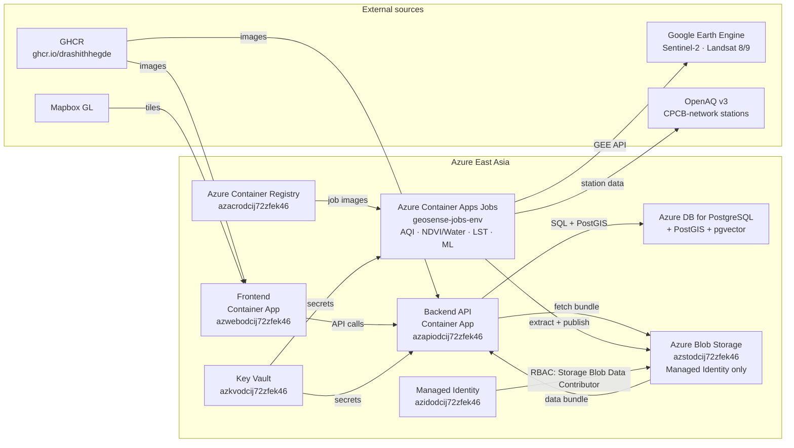

# GeoSense

Environmental intelligence for Indian cities from real satellite and ground-station data:
vegetation (NDVI), land surface temperature (LST), Water Health, air quality (CPCB AQI) and a
composite stress index, analysed on a 300 m grid with machine learning and explained with cited
retrieval-augmented generation (RAG).

**Live application:** https://azwebodcij72zfek46.wonderfulrock-df4f34b7.eastasia.azurecontainerapps.io

**API:** https://azapiodcij72zfek46.wonderfulrock-df4f34b7.eastasia.azurecontainerapps.io

| City | Study region | 300 m cells |
|---|---|---|
| **Mumbai** | Mumbai, Thane and Mira-Bhayandar municipal corporations | 8,300 |
| **Delhi** | National Capital Territory of Delhi | 17,004 |
| **Bengaluru** | BBMP area (243 wards, 2022 delimitation) | 8,229 |

Every value comes from real data. Missing data stays missing and is said to be missing; nothing is
filled in, borrowed from another city or made up.

---

## How it works

```text
Sentinel-2 (10 m) ──┐                         ┌─ NDVI, Water Health, NDMI GeoTIFFs ─┐
Landsat 8/9 (30 m) ─┼─ Google Earth Engine ───┼─ LST GeoTIFF                        ├─ map images (sharp/glow/halo)
OpenAQ v3 (CPCB) ───┴─ CPCB AQI → IDW ────────┴─ AQI GeoTIFF                        │
                                                                                      ├─ composite (heat + surface + air)
300 m grid (PostGIS) ─ zonal statistics per cell ─ Isolation Forests, XGBoost LST model, Water Health robust z
                                 │
FastAPI ─ click: PIXEL (exact GeoTIFF value) → 300 m CELL (live cell means + models + history) → MUNICIPALITY
        └─ explanation: evidence → rule-based findings → hybrid RAG (BM25 + bge-small, pgvector) → checked AI summary
React + Mapbox GL ─ city switcher, layers, legend, insight panel, Deep Analysis, Ask GeoSense
```

## Production architecture



* **Layers**: NDVI (14-day Sentinel-2 median), LST (45-day Landsat median, per-city cloud QC),
  Water Health (Sentinel-2 spectral proxy on water pixels), CPCB AQI (OpenAQ CPCB-network stations,
  48 h freshness rule, IDW k=4, NoData beyond 15 km), composite (weights 0.40/0.35/0.25, ≥2 of 3
  components, relative within each city).
* **ML per city**: Isolation Forest on land and per-layer observations, XGBoost LST-from-land-cover
  modelling with spatial block cross-validation (residual = "unexplained heat"), Water Health robust
  z, station pollutant-mix Isolation Forest, and validation against ESA WorldCover. Current saved
  model cards include per-city MAE/RMSE for LST, anomaly eligibility/counts, and relationship
  correlation metrics; they are research evidence, not official thresholds or causal findings.
* **History per city**: same-season, year-on-year change since 2023 (Mumbai and Delhi: pre- and
  post-monsoon; Bengaluru: winter and pre-monsoon), persistence, Theil-Sen trends, change Isolation
  Forest, and "which came first: heat or greenery".
* **RAG**: 59 curated, cited notes (including Delhi and Bengaluru context) plus 1,342 page-level
  passages from 12 source documents; hybrid BM25 + BAAI/bge-small-en-v1.5 retrieval fused with RRF.
  Evaluation: **49 questions, Recall@5 = 0.939, MRR = 0.770**. Another city's local notes are never
  used; AI text (Gemini → Groq) is checked against the evidence and dropped if it adds unsupported
  numbers, causes or flags.

## Repository layout

```text
client/                 React + Vite + Mapbox GL frontend
server/
  app/core/cities.py    the cities, their regions, seasons, QC thresholds; per-request city context
  app/api/              FastAPI routes (every request works on one city: ?city= or the clicked point)
  app/services/         surfaces, ML, history, RAG, provenance, ingestion logging
  scripts/              the data pipeline (every script takes --city)
    run_azure_job.py    idempotent entrypoint for Azure Container Apps Jobs
    data_bundle.py      pack / publish / rollback / fetch the versioned data bundle
  migrations/           Alembic (PostGIS + pgvector + ingestion_runs)
  data/                 Mumbai data; data/cities/<city>/ for the others (boundaries in git,
                        layers and models shipped as the data bundle)
  deploy/start.sh       container start: data bundle → database migrations → API
deploy/                 deploy scripts and audit utilities
.github/workflows/      api-image.yml (GHCR API image), ghcr-frontend-release.yml (GHCR frontend)
docker-compose.yml      local PostGIS + pgvector dev environment
```

## Run it locally (Windows)

```powershell
powershell -ExecutionPolicy Bypass -File .\setup.ps1             # install, database, Mumbai pipeline
powershell -ExecutionPolicy Bypass -File .\setup.ps1 -PipelineOnly -City delhi
powershell -ExecutionPolicy Bypass -File .\setup.ps1 -PipelineOnly -City bengaluru
.\run.ps1                                                         # backend + frontend, opens the browser
```

Any OS, by hand (from `server/`, Python 3.12, Postgres from `docker compose up -d db`):

```bash
pip install -r requirements-pipeline.txt
python scripts/db_init.py                          # PostGIS + pgvector + migrations
python scripts/setup_city.py --city delhi          # boundaries → cells → NDVI → Water Health → LST → NDMI
                                                   # → map images → AQI → composite → WorldCover → ML → history
uvicorn app.main:app --reload --port 8000
cd ../client && npm install && npm run dev         # http://localhost:5173
```

The satellite steps need Earth Engine credentials (`earthengine authenticate`, `GEE_PROJECT` in
`.env`) and AQI needs a free `OPENAQ_AQI_KEY`. `setup_city.py --from <step>` resumes after a failure;
each step is also a script of its own (`--city` on every one).

A fresh clone without the pipeline outputs can fetch them: `python scripts/data_bundle.py fetch --url <bundle URL>`.

## Main API

All endpoints take `?city=mumbai|delhi|bengaluru`; a request with `lon`/`lat` is answered for the city
that contains the point.

| Endpoint | |
|---|---|
| `GET /api/cities` | the cities and which layers each has |
| `GET /api/surfaces/{ndvi,lst,water-health,aqi,composite}/latest` | map layer images, legend, provenance |
| `GET /api/analysis/point?lon=&lat=` | pixel → 300 m cell → municipality |
| `GET /api/analysis/point/explain?lon=&lat=&focus=` | findings, ML, history, relationships, cited sources |
| `POST /api/assistant/ask` | grounded question answering about a place |
| `GET /api/ml/summary`, `/api/ml/hotspots` | model cards and flagged cells |
| `GET /api/provenance`, `/api/system/status`, `/api/health` | data freshness and pipeline status |
| `POST /api/admin/bundle/reload` | reload data bundle from Blob Storage (requires X-Admin-Token) |

## Data pipeline and scheduled jobs

The production backend fetches the validated data bundle from private Azure Blob Storage on startup
(via Managed Identity — no shared keys). Scheduled Azure Container Apps Jobs update the bundle
automatically:

| Job | Schedule | Tasks |
|---|---|---|
| `geosense-job-aqi` | Every 3 hours | AQI surface → composite → publish bundle |
| `geosense-job-satellite` | Mondays 02:00 UTC | NDVI + Water Health (Sentinel-2, only if new imagery) |
| `geosense-job-lst` | Every 4 days 03:00 UTC | LST (Landsat 8/9, only if new imagery) |
| `geosense-job-ml` | Tuesdays 04:00 UTC | ML pipeline → publish bundle |

Each job run is recorded in the `ingestion_runs` PostgreSQL table (visible at `/api/system/status`).
Every publish is versioned (`bundles/geosense-data-<timestamp>.tar.gz`); the previous bundle is
retained for one-command rollback (`python scripts/data_bundle.py rollback`).

**Limitations:** Satellite imagery is not real-time (Sentinel-2: 14-day composites, Landsat: 45-day
composites). LST is cloud-masked — cloudy periods produce no update. AQI is sourced only from
CPCB-network stations via OpenAQ; pixels beyond 15 km from the nearest station are NoData.

## Deploy

See [deploy/DEPLOY.md](deploy/DEPLOY.md). Primary deployment: Azure Container Apps (frontend +
backend), Azure Container Apps Jobs (scheduled ingestion), Azure Database for PostgreSQL with
PostGIS + pgvector, Azure Blob Storage (private, Managed Identity), Azure Container Registry, GHCR.

## Verified evaluation snapshot

* **RAG retrieval**: 49 evaluation questions; hybrid retrieval **Recall@5 = 0.939**, **MRR = 0.770**.
* **XGBoost LST-from-land-cover, spatial block cross-validation**:
  Mumbai: R² = 0.528, MAE = 2.181 °C, RMSE = 2.832 °C.
  Delhi: R² = 0.557, MAE = 1.160 °C, RMSE = 1.672 °C.
  Bengaluru: R² = 0.512, MAE = 1.363 °C, RMSE = 1.744 °C.
* **Other model evidence**: Isolation Forest counts and eligibility are reported per city and per layer;
  relationship results include Pearson/Spearman correlation and effect strength. These metrics describe
  model behaviour and consistency; they are not official regulatory thresholds or causal proof.

## Tests

```bash
cd server && python -m pytest tests -q      # database tests run when Postgres is reachable
```

## Data sources and licences

Sentinel-2 (ESA Copernicus), Landsat 8/9 (USGS) via Google Earth Engine; OpenAQ v3 (CPCB-network
stations); ESA WorldCover 2021; boundaries: OpenStreetMap (Mumbai), DataMeet Municipal Spatial Data
(Delhi, Bengaluru; CC BY-SA 2.5 India). Knowledge-base citations are listed with every note.
